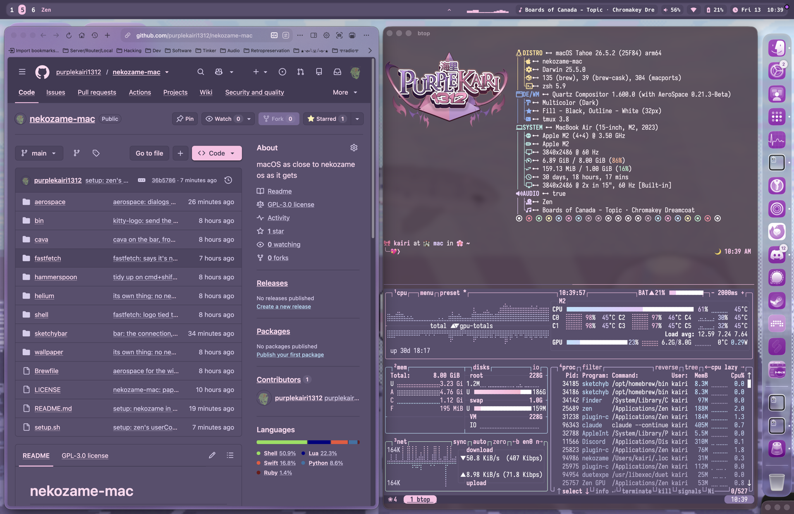
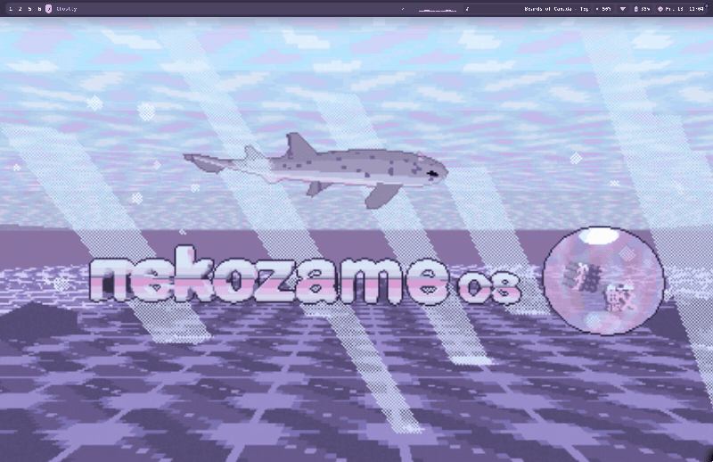

# nekozame-mac

nekozame for macOS.





- [AeroSpace](https://github.com/nikitabobko/AeroSpace) tiling: Ctrl+Option+arrows to focus, Shift to move, left Option+1-9 for workspaces (the right Option still types @, # and the rest on any keyboard layout). Every app has its own: 1 web, 2 terminal and Emacs, 3 chat and mail, 4 making music, 5 listening and watching, 6 drawing, photos and video, 7 games, 8 downloads
- Cmd for apps: Cmd+Return terminal, Cmd+E files, Cmd+Shift+E yazi, Cmd+B browser, on top of macOS's own. Cmd+Shift+/ shows every shortcut
- A rounded [SketchyBar](https://github.com/FelixKratz/SketchyBar) bar: workspaces, the app's menus (click its name), what's playing, volume and the clock
- The animated catshark wallpaper, sharp on any screen shape, with the nekozame logo small, big or not at all <3
- The [nekozame theme](https://git.sr.ht/~purplekairi1312/nekozame-theme) in Ghostty (see-through), Emacs (with the nekozame logo on Doom's dashboard), cava, btop and yazi, and fastfetch with the bubble logo
- macOS in nekozame colours, as far as it lets you: dark, pink accents, pink text selection and purple-tinted icons. Folder colours are yours to pick: right-click a folder in Finder
- Zen, ready for privacy: Dark Reader, uBlock Origin, Privacy Badger, LibRedirect, ClearURLs, Consent-O-Matic and [nekojs](https://git.sr.ht/~purplekairi1312/nekojs), DuckDuckGo, HTTPS-only, no telemetry, no WebRTC leaks (Helium optional, with the same). Zen in nekozame too: see-through toolbars, and pages, GitHub and YouTube in nekozame colours
- The nekozame theme in Discord (through Vencord) and Bitwig (through the Bitwig Theme Editor), when you have them. Run the setup again after they update
- Doom Emacs as `$EDITOR`, always running as a daemon (evil mode or another editor if you want)
- Tailscale and Moonlight
- Music production on request: Bitwig, Reaper, LMMS and free plugins

## Install

Needs [Homebrew](https://brew.sh).

```sh
git clone https://git.sr.ht/~purplekairi1312/nekozame-mac ~/.local/share/nekozame-mac
~/.local/share/nekozame-mac/setup.sh
```

It asks about the optional bits, and keeps your own configs where you have them (your dotfiles' links too). Run it again to update. Then give AeroSpace and Hammerspoon Accessibility access (System Settings → Privacy & Security), and log out and back in once.

## License

GPL-3.0-or-later. The wallpaper and logo are nekozame art, CC BY-NC-SA 4.0, downloaded when you install.
